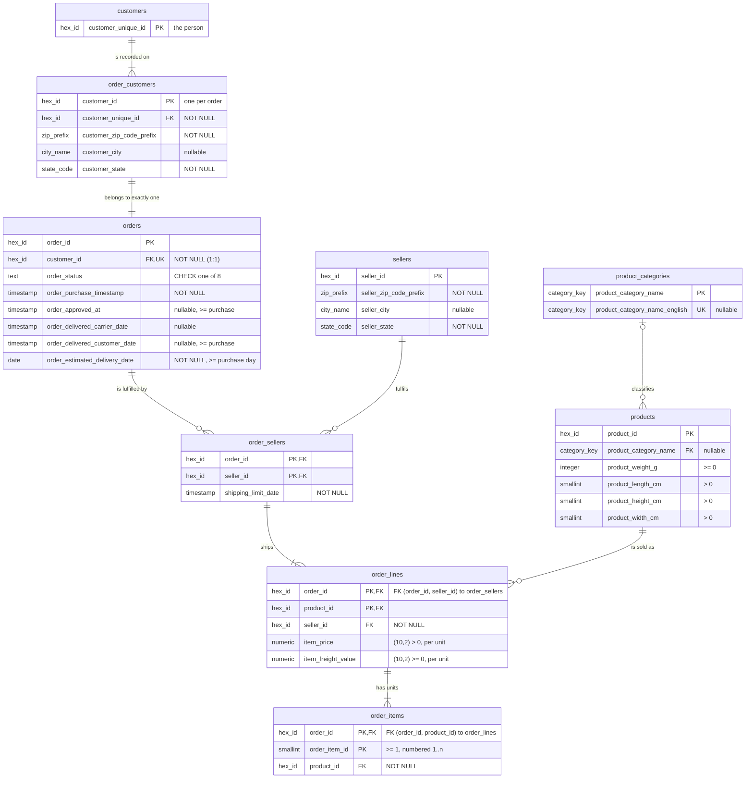

# ERD: Olist source schema (`olist`)

The diagram shows the nine tables of the `olist` schema, their keys and how they relate.
GitHub draws it from the Mermaid code below.

How to read it: the line ends use crow's-foot notation, where `||` means exactly one, `|o`
zero or one, `|{` one or more and `o{` zero or more. PK = primary key, FK = foreign key,
UK = unique. Column types are PostgreSQL types or the domains defined in
[`sql/schema.sql`](../sql/schema.sql) (`hex_id`, `zip_prefix`, `state_code`, `city_name`,
`category_key`).

## Relationships and how each rule is enforced

| Relationship | Cardinality | Enforced by |
|---|---|---|
| customers to order_customers | 1 to 1..N | FK `order_customers.customer_unique_id` (NOT NULL); the minimum of 1 is checked by verification |
| order_customers to orders | 1 to 1 | FK + UNIQUE on `orders.customer_id`; "every record used by an order" is checked by verification |
| orders to order_sellers | 1 to 0..N | FK; orders with no items (canceled/unavailable) are a valid exception |
| sellers to order_sellers | 1 to 0..N | FK; in the subset every seller has at least one (closure check) |
| order_sellers to order_lines | 1 to 1..N | composite FK `(order_id, seller_id)`; minimum of 1 checked by verification |
| products to order_lines | 1 to 0..N | FK; in the subset every product has at least one (closure check) |
| product_categories to products | 0..1 to 0..N | nullable FK (90 subset products have no category) |
| order_lines to order_items | 1 to 1..N | composite FK `(order_id, product_id)`; minimum of 1 checked by verification |

**Many-to-many relationships:** orders and sellers are linked through `order_sellers`.
Orders and products, and products and sellers (the same product can be sold by several
sellers), are linked through `order_lines`.

**Fact table:** `order_items`, one row per unit sold. Each unit takes its price and freight
from its `order_lines` row, and its seller and shipping deadline from `order_sellers`. Later
phases can slice it by product and category, seller, customer (through `orders` and
`order_customers`) and purchase date.

The `ingest` schema holds the loader's audit tables (`runs`, `source_files`, `table_loads`,
`run_measures`, `data_issues`). They record each run, are keyed by `run_id`, and are not
part of the business model.
